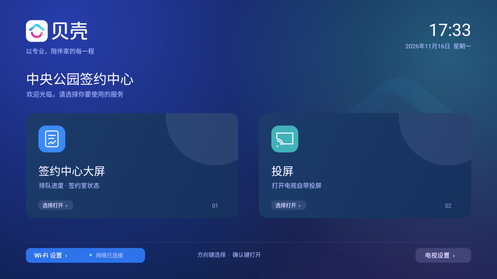

# beike-tv-home

这份 Skill 指导 Agent 制作和安装电视首页与独立签约中心大屏应用。先验证电视，再确认首页内容与应用链接，制作安装后分别验收页面、入口及开机启动。

适用于需要制作贝壳风格电视首页、签约中心大屏或网页展示应用的任务。支持按创维、海信、小米等具体设备的实际能力选择路线，不承诺所有型号兼容；非安卓系统不能直接安装 APK。

## 内容

- 设备验证：系统、型号、架构、分辨率、网络、调试连接及修改前备份。
- 内容确认：首页标题、地点、入口、品牌素材、遥控操作和启动偏好。
- 应用与链接确认：真实应用目标、完整网页地址、预览或发布版及登录方式。
- 大屏应用制作：独立APK、完整网页链接、全屏、扫码登录、遥控鼠标、刷新与返回，并提供应用工程模板。
- 安装与验收：真实遥控器、开机、待机唤醒、冷启动分别记录结果。
- 设计留档：本次应用图标、电视横幅、背景参数、焦点样式、实机预览及绘制参考。

## 在 Agent 中使用

下载并解压整个目录，保留 `SKILL.md`、`references/` 和 `assets/` 的相对位置。

- 支持导入 Skill 的 Agent：按平台说明导入包含 `SKILL.md` 的目录。
- 支持读取项目文件的 Agent：把目录放进工作区，直接发送下面这句话。

> 请阅读 beike-tv-home/SKILL.md，先核实我的电视型号和系统，再和我确认首页内容及应用入口。

制作安装包和连接电视需要执行本地工具的能力。仅支持对话的平台可以根据指南整理配置和现场操作步骤。

## 设计与使用范围

[技能主流程](SKILL.md) · [设计方案](references/beike-visual-design.md) · [设备验证](references/device-verification.md)

品牌 Logo 与相关商标归权利人所有；留档素材用于本项目复用参考，本仓库不授予相关商标或品牌素材的额外使用权。本技能不代表贝壳官方发布。

仓库不包含业务网页专用链接、账号登录会话、Wi-Fi 信息、ADB 密钥或电视安装包；每次部署需确认本次设备和入口目标。
